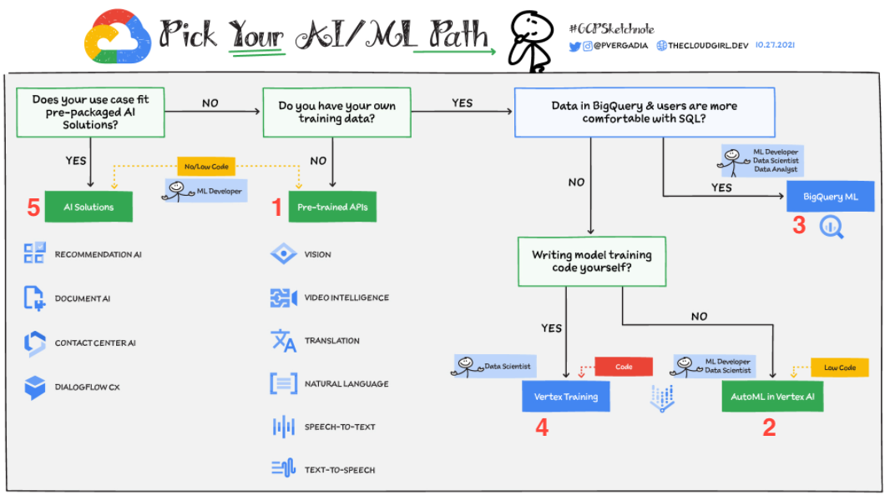

# Google Cloud — Enterprise AI Solutions, Demos & Reference Notebooks

**Customer-deployable Agentic AI, Generative AI, and MLOps solutions built on Google Cloud reference architectures — alongside hands-on demos and service-by-service ML notebooks.**

 -FBBC04.svg) 

---

## Customer-Facing AI Solutions (`solutions/`)

The [`solutions/`](solutions/README.md) directory houses turnkey, self-contained AI accelerators and vertical starters that customers can deploy into their own Google Cloud project in **under 15 minutes** on **Tier-1 Serverless (`≈ \$0–\$3/mo` idle)**—with optional **Tier-2 Enterprise** Terraform toggles (`AlloyDB`, `Spanner Graph`, `Vector Search`, `Healthcare FHIR`, `Dataflow`, `Cloud IAP`, `Private Service Connect`), Model Armor + Cloud DLP guardrails, and `Replay | Live` dual execution modes.

| Solution | Category | Industries | Core GCP AI Capabilities | Status |
| :--- | :--- | :--- | :--- | :---: |
| [**Enterprise GraphRAG & Contagion Explorer**](solutions/enterprise-graphrag/README.md) (`solutions/enterprise-graphrag`) | Multi-Pack Accelerator (3 Packs) | Supply Chain, Banking AML, Legal M&A | BigQuery Property Graph (ISO GQL), Spanner Graph (Tier-2), Vertex AI `gemini-embedding-2`, Google ADK `2.15`, Model Armor, Cloud Run | Phase 2 Complete (`50` tests passing · Live ADK `2.15` + BQ ISO GQL + Model Armor Verified) |

---

## Repository Map

```text
google-cloud/
├── solutions/                      # Customer-deployable AI Accelerators & Starters (Cloud Run + Terraform)
│   └── README.md                   # Solutions hub, deployment contract & live catalog
├── Demos/                          # Standalone end-to-end use-case demos (notebooks & container apps)
├── AI & Machine Learning/          # Service-by-service ML, BQML, Vertex AI & GenAI notebooks (01–07)
├── Data Analytics/                 # BigQuery & analytics reference assets
├── scripts/                        # Repo security/leak gate & 3-layer README synchronization checker
└── data/images/                    # Shared architecture diagrams & visual assets
```

---

## End-to-End Demos (`Demos/`)

Runnable single-use-case demonstrations showcasing specific Google Cloud AI services:

| Demo | Primary GCP Services | Format | Link |
| :--- | :--- | :--- | :--- |
| **Paint Color Recommendation using GenAI** | Vertex AI Generative AI, Cloud Run / Docker | Python App + `Dockerfile` | [`Demos/Paint Color Recommendation using GenAI/`](Demos/Paint%20Color%20Recommendation%20using%20GenAI/) |
| **Entity Extraction using Document AI** | Document AI Custom Processor, Cloud Storage | 3 Jupyter Notebooks | [`Demos/Entity extraction using Document AI/`](Demos/Entity%20extraction%20using%20Document%20AI/README.md) |
| **Real-Time Anomaly Detection** | Timeseries Insights API, Streaming Data | 3 Jupyter Notebooks | [`Demos/Real time anomaly detection using time series API/`](Demos/Real%20time%20anomaly%20detection%20using%20time%20series%20API/README.md) |

---

## AI & Machine Learning Reference Notebooks (`AI & Machine Learning/`)

Service-oriented guides and runnable Jupyter notebooks spanning Google Cloud's ML spectrum (see [`AI & Machine Learning/README.md`](AI%20%26%20Machine%20Learning/README.md)):

| Module | Topic | Highlights | Link |
| :--- | :--- | :--- | :--- |
| **01** | **Pre-built ML APIs** | Timeseries Insights anomaly detection, Cloud Natural Language sentiment & entity extraction | [`01 - Pre-built ML APIs`](AI%20%26%20Machine%20Learning/01%20-%20Pre-built%20ML%20APIs/README.md) |
| **02** | **AutoML** | AutoML Vision object detection workflow | [`02 - AutoML`](AI%20%26%20Machine%20Learning/02%20-%20AutoML/README.md) |
| **03** | **BigQuery ML (BQML)** | In-warehouse SQL machine learning patterns | [`03 - BQML`](AI%20%26%20Machine%20Learning/03%20-%20BQML/README.md) |
| **04** | **Vertex AI & Custom ML** | Custom model training & serving on Vertex AI | [`04 - Vertex AI & Custom ML`](AI%20%26%20Machine%20Learning/04%20-%20Vertex%20AI%20%26%20Custom%20ML/README.md) |
| **05** | **AI Industry Solutions** | Document AI, Healthcare NLP, Discovery AI | [`05 - AI Solutions`](AI%20%26%20Machine%20Learning/05%20-%20AI%20Solutions/README.md) |
| **06** | **End-to-End MLOps** | Automated CI/CD/CT pipelines on Google Cloud | [`06 - End-to-End MLOps`](AI%20%26%20Machine%20Learning/06%20-%20End-to-End%20MLOps/README.md) |
| **07** | **Generative AI** | Python SDK language samples & LangChain intro notebooks | [`07 - GenAI`](AI%20%26%20Machine%20Learning/07%20-%20GenAI/README.md) |



For BigQuery & data engineering assets, see [`Data Analytics/`](Data%20Analytics/README.md).

---

## Security, Hygiene & Maintainer Standards

- **Zero-Identity & Secret Hygiene**: Never commit GCP project IDs, numeric project numbers, live Cloud Run URLs, service account JSON keys, `.env` files, or local internal tracking docs. All deployment configs read from git-ignored `.env` / `deploy/*.env` templates.
- **Automated Pre-Push Verification**: Run `./scripts/check_repo_hygiene.sh` before every push to enforce secret scanning and verify that every solution added under `solutions/` updates its local `README.md`, [`solutions/README.md`](solutions/README.md), and this root `README.md`.

## Official Google Cloud Architecture Resources

- [Cloud Architecture Center — Agentic AI Guides](https://docs.cloud.google.com/architecture/agentic-ai-overview)
- [Cloud Architecture Center — Generative AI Guides](https://docs.cloud.google.com/architecture/genai-overview)
- [Cloud Architecture Center — ML Applications & Operations Guides](https://docs.cloud.google.com/architecture/ai-ml/ml-application-operations-architecture-guides)
- [Google Cloud Well-Architected Framework](https://docs.cloud.google.com/architecture/framework)

## License

This repository is licensed under the [MIT License](LICENSE).
