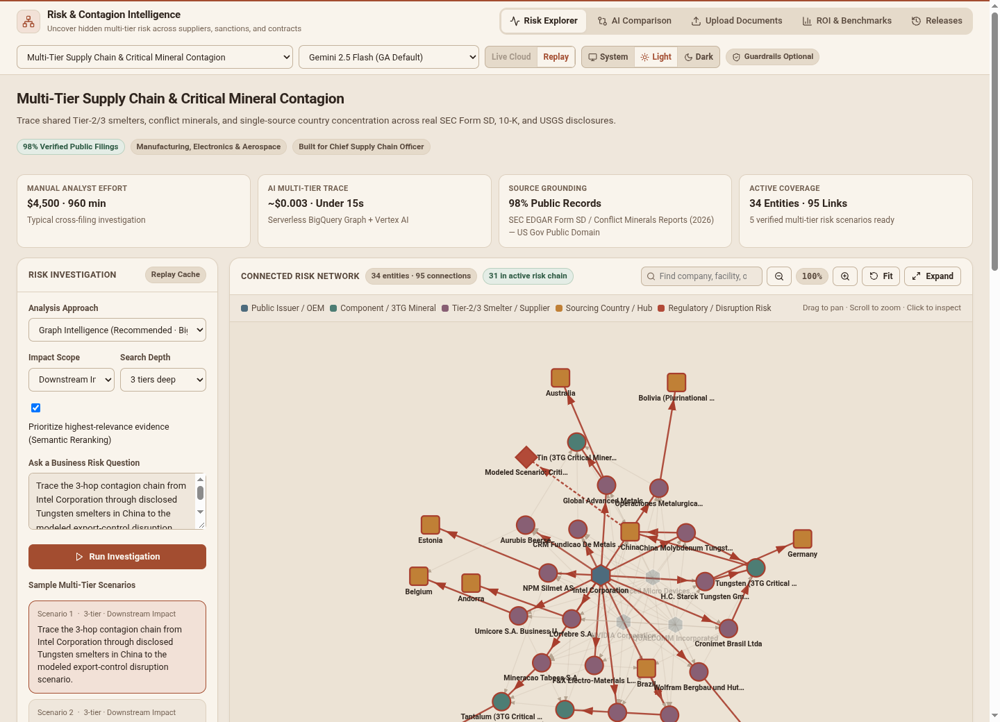
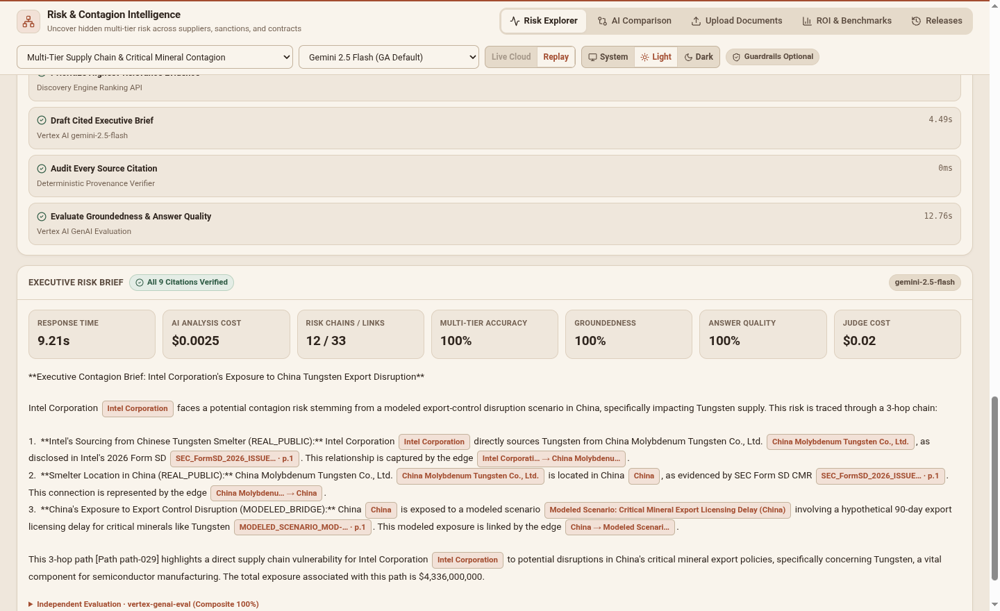
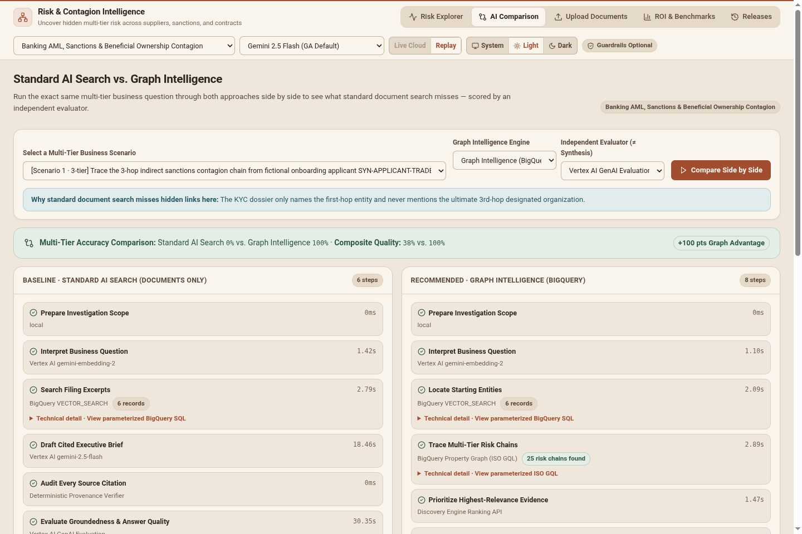
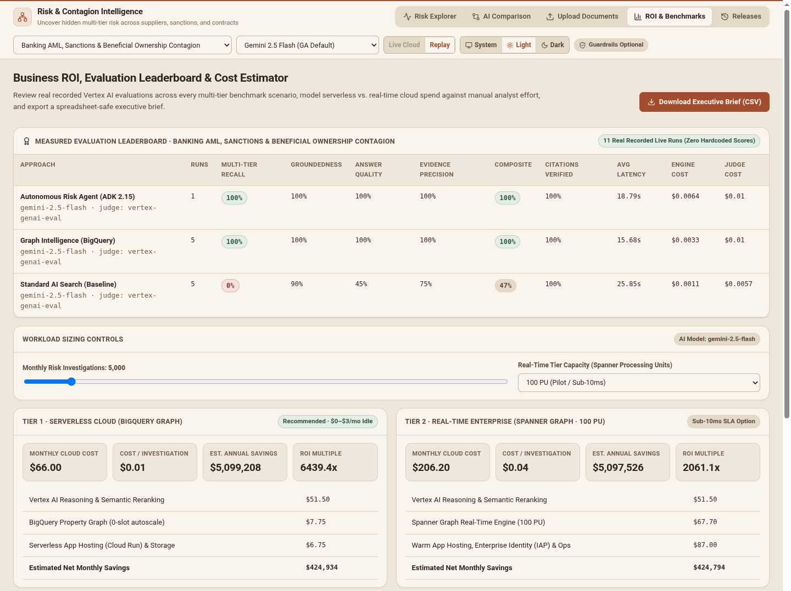
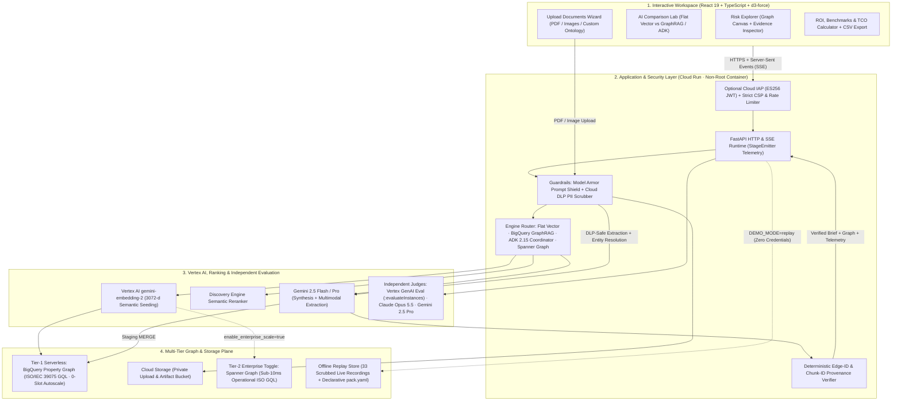

# Risk & Contagion Intelligence — Enterprise GraphRAG on Google Cloud

**Uncover hidden 2-to-4 hop supply chain, sanctions, and legal contract contagion that traditional vector search misses — built with BigQuery Property Graph (ISO/IEC 39075 GQL), Vertex AI, Google ADK, Model Armor, and Cloud Run.**

-34A853.svg)   

---

## The Problem This Solves

Enterprise risk rarely lives inside a single document. Traditional **Flat Vector RAG** retrieves semantically similar paragraphs in isolation — so when an exposure chain spans **2 to 4 hops across separate filings, corporate registries, and contracts**, vector search returns partial or zero multi-tier findings.

| Domain | The Real-World Blind Spot | Manual Investigation Baseline | How Enterprise GraphRAG Solves It |
| :--- | :--- | :---: | :--- |
| **Supply Chain & Critical Minerals** | An OEM's SEC `Form SD` names Tier-2/3 smelters, while separate USGS mineral summaries disclose single-country refining chokepoints. | **16 hours** (`$4,500` / audit) | Traverses `Issuer -> Mineral -> Smelter -> Country -> Disruption` paths across filings and exposes shared chokepoints in seconds. |
| **Banking AML & Sanctions Compliance** | Individual US Treasury OFAC SDN records cite direct 1-hop `Linked To:` relationships; indirect exposure hides 2–4 hops deep behind shell and parent hierarchies. | **6 hours** (`$850` / case) | Joins OFAC SDN graphs with GLEIF LEI ownership hierarchies via ISO GQL `ANY SHORTEST` path queries to surface hidden indirect sanctions links. |
| **Corporate Legal & M&A Diligence** | Target subsidiaries hold dozens of commercial contracts whose `Change of Control`, `Anti-Assignment`, and `IP Ownership` clauses trigger cascading termination risk across jurisdictions. | **10 hours** (`$3,200` / review) | Connects `Deal -> Target -> Contract -> Clause -> Jurisdiction` in a queryable property graph with exact source clause citations. |

---

## Business & Technical Impact

Across **15 path-verified multi-hop scenarios** evaluated over **33 live runs** using real public filings, registries, and contracts:

- **Closes the Multi-Hop Blind Spot (`0.00` → `0.88–1.00` Multi-Tier Recall)**: Flat Vector RAG scored **`0.00`** multi-tier recall across every industry pack because no single chunk contains the full chain. BigQuery GraphRAG and the Google ADK Coordinator recovered **`88%–100%`** of full multi-hop contagion paths.
- **Hours to Seconds at Sub-Cent Unit Cost**: Replaces **6–16 hours** (`$850–$4,500`) of manual cross-document investigation with auditable, path-cited briefs generated in seconds for **`$0.003–$0.006` per query**.
- **Zero Hallucinated Graph Citations (`100%` Verified Provenance)**: A deterministic Edge-ID and Chunk-ID verifier checks every cited claim against the traversed subgraph before returning the answer (`33/33` live runs verified with zero unverified edges).
- **Serverless Economics with Enterprise Scale-Up**: Runs on **Tier-1 Serverless** (`$0–$3/mo` idle via Cloud Run `min-instances=0` + BigQuery Property Graph `0`-slot autoscale), with a single Terraform toggle (`enable_enterprise_scale=true`) to activate **Tier-2 Spanner Graph** for sub-10ms operational scale.
- **Zero-Credential Interactive Demo + Bring-Your-Own-Data**: Runs immediately out-of-the-box in deterministic **Replay** mode or switches to **Live** mode on Vertex AI, and lets teams upload their own PDFs, images, or custom ontologies through a Cloud DLP-screened `/ingest` wizard.

### Measured Benchmark Results (33 Live Runs)

All metrics below are computed deterministically from recorded live runs in `data/recordings/` (`gemini-2.5-flash` synthesis evaluated independently by **Vertex AI GenAI Evaluation `:evaluateInstances` `PointwiseMetric`** pinned to `gemini-2.5-pro`; `judge_model != synthesis_model` enforced server-side):

| Industry Pack | Retrieval Engine (`n` runs) | Multi-Tier Recall | Groundedness | Composite Score | Provenance Verified | Avg Engine Cost | Avg Judge Cost |
| :--- | :--- | :---: | :---: | :---: | :---: | :---: | :---: |
| **Banking AML & Sanctions** | Flat Vector RAG (`n=5`) | `0.00` | `0.90` | `0.47` | `100%` | `$0.0011` | `$0.0057` |
| **Banking AML & Sanctions** | **BigQuery GraphRAG (`n=5`)** | **`1.00`** | **`1.00`** | **`1.00`** | **`100%`** | `$0.0033` | `$0.0118` |
| **Banking AML & Sanctions** | **Google ADK Coordinator (`aml_q01`)** | **`1.00`** | **`1.00`** | **`1.00`** | **`100%`** | `$0.0064` | `$0.0142` |
| **Legal M&A Diligence** | Flat Vector RAG (`n=5`) | `0.00` | `0.90` | `0.40` | `100%` | `$0.0017` | `$0.0083` |
| **Legal M&A Diligence** | **BigQuery GraphRAG (`n=5`)** | **`0.88`** | **`0.90`** | **`0.81`** | **`100%`** | `$0.0040` | `$0.0217` |
| **Legal M&A Diligence** | **Google ADK Coordinator (`ma_q01`)** | **`1.00`** | **`1.00`** | **`1.00`** | **`100%`** | `$0.0065` | `$0.0211` |
| **Supply Chain Risk** | Flat Vector RAG (`n=5`) | `0.00` | `1.00` | `0.63` | `100%` | `$0.0011` | `$0.0065` |
| **Supply Chain Risk** | **BigQuery GraphRAG (`n=5`)** | **`0.88`** | **`1.00`** | **`0.77`** | **`100%`** | `$0.0030` | `$0.0161` |
| **Supply Chain Risk** | **Google ADK Coordinator (`sc_q01`)** | **`1.00`** | **`1.00`** | **`0.73`** | **`100%`** | `$0.0027` | `$0.0182` |

---

## Application Walkthrough

### 1. Risk Explorer — Interactive Multi-Hop Contagion Network

Switch between industry packs (**Supply Chain**, **Banking AML & Sanctions**, **Legal M&A**) and trace 2-to-4 tier upstream or downstream exposure across an interactive `d3-force` risk graph (drag to pan, scroll to zoom, filter entities, or expand full width). Highlighted edges isolate the active contagion chain alongside upfront executive KPIs comparing manual audit cost (`$4,500 · 960 min`) against serverless GraphRAG (`~$0.003`).



### 2. Verified Executive Risk Brief & Clickable Source Citations

Every generated brief passes through the **Deterministic Provenance Verifier** before rendering. Each inline entity, relationship, and filing pill (`Intel Corporation`, `China Molybdenum Tungsten Co., Ltd.`, `SEC_FormSD_2026... · p.1`) is verified against the traversed subgraph and opens the primary-source Evidence Inspector—paired with stage-by-stage timing, transparent `Engine $` vs. `Judge $` cost, and independent Vertex AI GenAI Evaluation scores.



### 3. AI Comparison Lab — Standard Vector Search vs. Graph Intelligence

Run the exact same multi-hop business question side by side through **Flat Vector RAG** and **BigQuery GraphRAG** (or the **Google ADK Coordinator**). Live execution rails show every retrieval step—including expandable parameterized BigQuery SQL and ISO GQL queries—demonstrating why flat chunk retrieval scores **`0%`** multi-tier recall while GraphRAG recovers **`100%`** (`+100 pts Graph Advantage`).



### 4. Business ROI, Evaluation Leaderboard & Cloud TCO Estimator

Review aggregated scores across all recorded live evaluation runs (zero hardcoded benchmarks), size monthly investigation volume with the interactive workload slider, compare **Tier-1 Serverless (BigQuery Property Graph)** against **Tier-2 Real-Time Enterprise (Spanner Graph)** monthly spend and ROI multiples, and export a spreadsheet-safe CSV Executive Brief.



---

## System Architecture



### Architecture Component Breakdown

| Layer | Component | GCP Service / Technology | Responsibility |
| :--- | :--- | :--- | :--- |
| **Experience** | **Multi-Tab Workspace SPA** (`frontend/`) | React 19, TypeScript, Vite, `d3-force` | Full-width interactive risk graph (pan, wheel zoom, expand view, click-to-inspect source filings), side-by-side Flat vs. GraphRAG comparison, BYO-data upload wizard, ROI/TCO dashboard, and persistent state across tab switches. |
| **API & Streaming** | **Async API & Telemetry** (`backend/app/main.py`, `api/routes.py`) | Cloud Run, FastAPI, SSE (`StageEmitter`) | Streams live stage-by-stage progress (`model_armor`, `embed`, `gql_traverse`, `rerank`, `synthesize`, `verify`, `evaluate`), enforces strict Pydantic schemas, and serves the compiled SPA from a single container. |
| **Guardrails & Security** | **Defense-in-Depth Middleware** (`core/security.py`, `ingestion/dlp_guard.py`) | Model Armor, Cloud DLP, Cloud IAP | Screens prompts against injection/jailbreaks via Model Armor, redacts PII before document ingestion via Cloud DLP, enforces strict `style-src 'self'` CSP, non-wildcard CORS, rate limits, and optional Cloud IAP `ES256` JWT validation. |
| **Retrieval & Agent Engines** | **4 Pluggable Engines** (`backend/app/engines/`) | BigQuery Property Graph, Google ADK `2.15`, Spanner Graph, Vertex AI | Supports `flat_vector_rag` (baseline), `bq_graphrag` (hybrid vector + canonical-name seeding + parameterized ISO GQL `MATCH p = ANY SHORTEST`), `adk_graph_coordinator` (`LlmAgent` + `InMemoryRunner` + mandatory `verify_draft_citations` tool loop), and `spanner_graphrag` (Tier-2 toggle). |
| **Trust & Verification** | **Deterministic Provenance & GQL Builder** (`gql_builder.py`, `provenance_verifier.py`) | Python (pure deterministic checks) | Prevents GQL injection via strict parameterized query templates and validates every `[EDGE:...]` / `[CHUNK:...]` citation in the synthesized brief against retrieved graph evidence. |
| **Multimodal BYO-Data** | **Self-Service Ingestion** (`backend/app/ingestion/`, `packs/entity_resolver.py`) | PyMuPDF, Gemini Vision, Cloud DLP, BigQuery `MERGE` | Validates uploads, extracts text/vision triples against an active or custom YAML ontology, scrubs PII via Cloud DLP, resolves canonical entities in `O(N)` time, and stages idempotent updates into BigQuery. |
| **Evaluation & Economics** | **Independent Judging & TCO** (`backend/app/evaluation/`, `core/pricing.py`) | Vertex AI GenAI Evaluation, Anthropic Claude Opus 5.5, Gemini 2.5 Pro | Scores Groundedness, Multi-Hop Completeness, and Actionability using an independent judge (`judge_model != synthesis_model`), splits `Engine $` vs. `Judge $`, and models Tier-1 vs. Tier-2 Monthly GCP TCO. |
| **Infrastructure as Code** | **Serverless + Enterprise IaC** (`infra/terraform/`, `infra/sql/`) | Terraform, Cloud Build, Artifact Registry, IAM | Provisions least-privilege service accounts (zero JSON keys), BigQuery Property Graph DDL, GCS, Model Armor, and dual Cloud Run services (IAP-protected Live UI + zero-credential Public Replay), with an optional `enable_enterprise_scale=true` Spanner Graph module. |

### How a Multi-Hop Investigation Executes

1. **Prompt Screening**: Incoming user queries are screened by **Model Armor** before any database or model call executes.
2. **Hybrid Seed Discovery**: **Vertex AI `gemini-embedding-2`** (`3072`-d) combined with canonical alias matching resolves query entities into graph seed nodes.
3. **Parameterized ISO GQL Traversal**: A strictly parameterized `MATCH p = ANY SHORTEST` query traverses 1-to-4 hops across **BigQuery Property Graph** (or **Spanner Graph** in Tier-2), returning full paths, edge confidences, dollar exposures, and linked evidence chunks.
4. **Reranking & Synthesis**: **Discovery Engine** reranks supporting evidence excerpts before **Gemini 2.5** (or the **Google ADK Coordinator**) drafts an executive risk brief citing exact edges and source excerpts.
5. **Deterministic Provenance Gate**: Every citation in the draft is verified against the actual traversed subgraph; ungrounded references are flagged or repaired before the answer streams to the UI.
6. **Independent Evaluation (Optional)**: An independent judge (**Vertex AI GenAI Eval**, **Claude Opus 5.5**, or **Gemini 2.5 Pro**) scores groundedness and multi-hop completeness alongside live latency, split engine/judge cost, and analyst savings.

---

## Included Industry Packs (Real Public Data)

Each pack is defined declaratively via `pack.yaml` (ontology node/edge types, visual legend, manual cost baseline, and golden benchmark scenarios) and curated from permissively licensed public datasets (`92.5%–97.8% REAL_PUBLIC`). Full attribution and licenses are documented in [NOTICE](NOTICE).

| Pack ID | Industry & Executive Persona | Real Public Data Sources | Entities / Edges / Chunks | Real Public Share |
| :--- | :--- | :--- | :---: | :---: |
| **`supply_chain_subtier_risk`** | Manufacturing & Semiconductors (*Chief Supply Chain Officer*) | 2026 SEC EDGAR `Form SD` Conflict Minerals Reports (Intel, NVIDIA, AMD, QUALCOMM) + USGS 2025 Mineral Commodity Summaries (*US Gov Public Domain*) | `34` / `95` / `9` | **97.8%** |
| **`banking_aml_ubo_contagion`** | Banking AML & Sanctions (*Head of AML Compliance*) | US Treasury OFAC SDN/ALT/ADD explicit `Linked To:` graph + GLEIF LEI corporate hierarchies (*Public Domain / `CC0 1.0`*) | `26` / `33` / `21` | **92.5%** |
| **`legal_ma_clause_graph`** | Corporate Legal & M&A (*General Counsel / Deal Partner*) | CUAD v1 (`CC-BY 4.0`) real SEC `Exhibit 10` commercial contracts with lawyer-annotated CoC, Anti-Assignment, License & IP clauses | `43` / `78` / `12` | **92.5%** |

*(Hypothetical disruption scenarios, fictional commercial bank onboarding applicants `SYN-APPLICANT-*`, and portfolio acquisition groupings are transparently tagged `data_origin="MODELED_BRIDGE"` in every table and UI badge.)*

---

## Project Structure

```text
solutions/enterprise-graphrag/
├── Dockerfile                        # Multi-stage non-root image (Node 22 build -> Python 3.12 runtime, UID 10001)
├── NOTICE                            # Public dataset licenses & attributions (SEC EDGAR, USGS, OFAC, GLEIF, CUAD)
├── .env.example                      # Local runtime configuration template
├── backend/
│   ├── requirements.txt              # Direct Python dependencies
│   ├── requirements.lock             # Fully pinned reproducible build lockfile
│   ├── app/
│   │   ├── main.py                   # FastAPI entrypoint, security middleware & SPA static mounting
│   │   ├── api/routes.py             # REST & SSE streaming endpoints (/query, /compare, /ingest, /benchmarks)
│   │   ├── core/                     # Settings, models, GCP clients, pricing/TCO, security, telemetry & attribution
│   │   ├── engines/                  # Flat Vector, BigQuery GraphRAG, ADK 2.15 Coordinator, Spanner, GQL & Provenance
│   │   ├── evaluation/               # Vertex GenAI Eval / Claude Opus 5.5 / Gemini judges + benchmark aggregator
│   │   ├── ingestion/                # Upload validation, Cloud DLP scrubber, multimodal extractor & BigQuery MERGE
│   │   └── packs/                    # Declarative pack.yaml loader & O(N) canonical entity resolver
│   └── tests/                        # 65 offline tests (contracts, GQL, provenance, security, eval, replay, deploy)
├── frontend/
│   ├── src/
│   │   ├── App.tsx                   # Persistent multi-tab shell with System / Light / Dark warm Bohemian themes
│   │   ├── api/client.ts             # Typed REST & SSE streaming client
│   │   ├── components/               # GraphCanvas (d3-force), EvidenceInspector, CitedAnswer, StageRail, Shell
│   │   ├── pages/                    # ExplorerPage, ComparePage, IngestPage, BenchmarkPage, ReleasesPage
│   │   └── styles/                   # Strict CSP-safe external CSS tokens & layout (zero inline styles)
│   └── tests/frontend.test.ts        # 7 unit, security, CSP & evaluation guardrail suites
├── packs/
│   ├── supply_chain_subtier_risk/    # pack.yaml, benchmark.json, SHA-256 MANIFEST.json & curated corpus JSON
│   ├── banking_aml_ubo_contagion/    # pack.yaml, benchmark.json, SHA-256 MANIFEST.json & curated corpus JSON
│   └── legal_ma_clause_graph/        # pack.yaml, benchmark.json, SHA-256 MANIFEST.json & curated corpus JSON
├── data/
│   ├── recordings/                   # 33 scrubbed live-recorded Replay fixtures across all 3 industry packs
│   └── releases.json                 # Structured release notes powering the in-app Releases view
├── docs/
│   └── images/                       # Application walkthrough screenshots embedded in README.md
├── infra/
│   ├── sql/                          # BigQuery Property Graph & Spanner Graph ISO GQL DDL schemas
│   └── terraform/                    # Modular Tier-1 Serverless + Tier-2 Spanner Graph IaC (apis, iam, bq, run)
├── deploy/
│   └── cloudrun.env.example          # Deployment configuration template (git-ignored cloudrun.env on deploy)
└── scripts/
    ├── deploy.sh                     # Turnkey Cloud Build + IAM + GCS + Model Armor + Cloud Run deployer
    ├── teardown.sh                   # Safe environment teardown (preserves BigQuery/GCS unless --purge-data)
    ├── seed_data.py                  # Idempotent BigQuery Property Graph loader & embedding generator
    ├── fetch_public_datasets.py      # Reproducible public dataset curator
    ├── provision_model_armor.py      # Creates/verifies dedicated Model Armor prompt-shield template
    ├── record_live_benchmarks.py     # Live benchmark recorder & identifier scrubber for Replay fixtures
    └── inventory_resources.sh        # Cloud Asset Inventory & Model Armor resource audit script
```

---

## API Reference

| Method & Path | Purpose |
| :--- | :--- |
| `GET /health` | Container liveness, active runtime mode (`replay` / `live`), and version metadata. |
| `GET /api/v1/meta` | Returns available engines, synthesis/judge model catalog, and active deployment flags. |
| `GET /api/v1/packs` | Lists available industry packs, ontologies, manual cost baselines, and golden questions. |
| `GET /api/v1/packs/{pack_id}/graph` | Returns bounded subgraph nodes and edges for interactive `d3-force` visualization. |
| `POST /api/v1/query/stream` | Streams stage-by-stage SSE telemetry, traversed risk subgraph, verified brief, citations, and optional independent judge scores. |
| `POST /api/v1/compare/stream` | Runs **Flat Vector RAG** side-by-side against **BigQuery GraphRAG** or **ADK Coordinator** over SSE with paired scoring and ROI delta. |
| `POST /api/v1/ingest/upload` | Validates uploaded PDF/image/text documents, scans PII via Cloud DLP, extracts ontology triples, and optionally commits via BigQuery `MERGE`. |
| `GET /api/v1/benchmarks/summary` | Aggregates measured multi-tier recall, groundedness, composite score, provenance rate, and split cost from `data/recordings/`. |
| `POST /api/v1/tco/estimate` | Models projected Monthly GCP TCO and net ROI across Tier-1 Serverless and Tier-2 Enterprise scale. |
| `GET /api/v1/releases` | Returns structured release metadata for the in-app Releases page. |

---

## Quickstart

### 1. Run Locally (Zero-Credential Replay Works Out of the Box)

```bash
cd solutions/enterprise-graphrag

# Install Python dependencies into an isolated virtual environment
uv venv .venv --python python3
uv pip install --python .venv/bin/python -r backend/requirements.txt

# Run the offline backend test suite (65 tests)
PYTHONPATH=backend .venv/bin/pytest backend/tests -v

# Build and verify the React 19 + TypeScript frontend (7 suites)
cd frontend && npm install && npm test && npm run build && cd ..

# Launch FastAPI + compiled React SPA locally on http://127.0.0.1:8000
PYTHONPATH=backend .venv/bin/uvicorn app.main:app --host 127.0.0.1 --port 8000
```

### 2. Deploy to Google Cloud (`< 15 Minutes` · Tier-1 `$0–$3/mo` Idle)

#### Option A · One-Command Cloud Run Deploy (No Local Docker Required)

```bash
cd solutions/enterprise-graphrag
cp deploy/cloudrun.env.example deploy/cloudrun.env  # git-ignored; set GCP_PROJECT_ID & IAP_MEMBERS
./scripts/deploy.sh --dry-run                       # preview APIs, IAM, Cloud Build & Cloud Run plan
./scripts/deploy.sh --yes                           # build, seed BigQuery Property Graph & deploy Live (IAP) + Replay

# Inspect provisioned GCP resources or cleanly tear down when finished
GCP_PROJECT_ID=<your-project-id> ./scripts/inventory_resources.sh
./scripts/teardown.sh --dry-run
./scripts/teardown.sh --yes
```

#### Option B · Terraform IaC (`infra/terraform/`)

```bash
cd solutions/enterprise-graphrag/infra/terraform
cp terraform.tfvars.example terraform.tfvars  # set project_id, container_image & iap_members
terraform init
terraform plan                                # Tier-1 Serverless default ($0-$3/mo idle)
terraform apply                               # Set enable_enterprise_scale=true to add Tier-2 Spanner Graph
```

---

## Security & Trust Defaults

- **Prompt & Output Defense**: Model Armor screens untrusted prompts and uploaded document text before synthesis; Cloud DLP inspects and redacts PII during `/ingest`.
- **Zero-Trust Querying & Provenance**: Parameterized ISO GQL prevents injection; the deterministic provenance verifier validates every edge and chunk ID against retrieved evidence.
- **Hardened Web & Cloud Run Posture**: Strict `style-src 'self'` Content Security Policy (zero inline styles, zero `localStorage`), non-root container (`UID 10001`), least-privilege runtime service account (zero exported JSON keys), and optional Cloud IAP (`ES256` JWT) protection for live mode.
