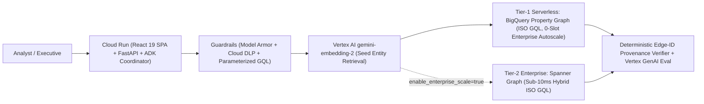

# Enterprise GraphRAG & Contagion Explorer (`solutions/enterprise-graphrag`)

**Ontology-driven multi-hop GraphRAG on Google Cloud — combining Vertex AI `gemini-embedding-2` with ISO/IEC 39075 GQL traversals on BigQuery Property Graph (`$0/mo` idle Tier-1) and Spanner Graph (Tier-2 Enterprise toggle).**

-34A853.svg)   

## The Problem

Flat vector RAG excels at single-document lookup, but misses **2-to-4 hop risk and contagion chains** split across separate filings, contracts, and sanctions records:
- **Supply Chain**: A chipmaker's SEC `Form SD` names Tier-2/3 smelters, while separate USGS mineral summaries disclose which country dominates that mineral's global refining share.
- **Banking AML / Sanctions**: Individual US Treasury OFAC SDN records only cite direct 1-hop `Linked To:` relationships; uncovering 3-hop indirect exposure requires traversing across multiple SDN entries.
- **Legal M&A Diligence**: Acquisition targets link to commercial agreements containing lawyer-annotated `Change of Control`, `Anti-Assignment`, and `IP Ownership` triggers across distinct governing-law venues.

## Architecture Overview



## Real Public Industry Packs Included (Zero Fabricated Core Data)

Every pack ships with a declarative `pack.yaml` ontology, curated real public excerpts (`92.5%–97.8% REAL_PUBLIC`), SHA-256 `MANIFEST.json`, and 5 path-verified multi-hop golden benchmark questions (`15` total). Full attribution lives in [NOTICE](NOTICE).

| Pack ID | Industry | Real Public Sources | Entities / Edges / Chunks | Real Public Share |
| :--- | :--- | :--- | :---: | :---: |
| **`supply_chain_subtier_risk`** | Manufacturing & Semiconductors | 2026 SEC EDGAR `Form SD` CMRs (Intel, NVIDIA, AMD, QUALCOMM) + USGS 2025 Mineral Commodity Summaries (*US Gov Public Domain*) | `34` / `95` / `9` | **97.8%** |
| **`banking_aml_ubo_contagion`** | Banking AML & Sanctions | US Treasury OFAC SDN/ALT/ADD explicit `Linked To:` multi-hop graph + GLEIF LEI (`CC0 1.0`) | `26` / `33` / `21` | **92.5%** |
| **`legal_ma_clause_graph`** | Corporate Legal & M&A | CUAD v1 (`CC-BY 4.0`) real SEC `Exhibit 10` commercial contracts with lawyer-annotated CoC, Anti-Assignment, License & IP clauses | `43` / `78` / `12` | **92.5%** |

*(Hypothetical disruption scenarios, fictional commercial bank onboarding applicants `SYN-APPLICANT-*`, and portfolio acquisition groupings are explicitly labeled `data_origin="MODELED_BRIDGE"` in every table and UI badge.)*

## Live Benchmark Snapshot (Phase 4 — 33 Recorded Live Runs, Vertex AI GenAI Eval `:evaluateInstances`)

Every metric below is aggregated directly from genuine recorded live runs under `data/recordings/` (`gemini-2.5-flash` synthesis evaluated independently by **Vertex AI GenAI Evaluation `:evaluateInstances` `PointwiseMetric`** with `autoraterConfig` pinned to `gemini-2.5-pro`; `judge_model != synthesis_model` enforced server-side, `100%` deterministic citation verification across all `33/33` runs):

| Industry Pack | Engine (`n` runs) | Multi-Tier Recall | Groundedness | Composite Score | Provenance Verified | Avg Engine Cost | Avg Judge Cost |
| :--- | :--- | :---: | :---: | :---: | :---: | :---: | :---: |
| **`banking_aml_ubo_contagion`** | Flat Vector RAG (`n=5`) | `0.00` | `0.90` | `0.47` | `100%` | `$0.0011` | `$0.0057` |
| **`banking_aml_ubo_contagion`** | **BigQuery GraphRAG (`n=5`)** | **`1.00`** | **`1.00`** | **`1.00`** | **`100%`** | `$0.0033` | `$0.0118` |
| **`banking_aml_ubo_contagion`** | **Google ADK 2.15 (`aml_q01`)** | **`1.00`** | **`1.00`** | **`1.00`** | **`100%`** | `$0.0064` | `$0.0142` |
| **`legal_ma_clause_graph`** | Flat Vector RAG (`n=5`) | `0.00` | `0.90` | `0.40` | `100%` | `$0.0017` | `$0.0083` |
| **`legal_ma_clause_graph`** | **BigQuery GraphRAG (`n=5`)** | **`0.88`** | **`0.90`** | **`0.81`** | **`100%`** | `$0.0040` | `$0.0217` |
| **`legal_ma_clause_graph`** | **Google ADK 2.15 (`ma_q01`)** | **`1.00`** | **`1.00`** | **`1.00`** | **`100%`** | `$0.0065` | `$0.0211` |
| **`supply_chain_subtier_risk`** | Flat Vector RAG (`n=5`) | `0.00` | `1.00` | `0.63` | `100%` | `$0.0011` | `$0.0065` |
| **`supply_chain_subtier_risk`** | **BigQuery GraphRAG (`n=5`)** | **`0.88`** | **`1.00`** | **`0.77`** | **`100%`** | `$0.0030` | `$0.0161` |
| **`supply_chain_subtier_risk`** | **Google ADK 2.15 (`sc_q01`)** | **`1.00`** | **`1.00`** | **`0.73`** | **`100%`** | `$0.0027` | `$0.0182` |

## Deploy to Your Google Cloud Project (< 15 Minutes · Tier-1 `$0–$3/mo` Idle)

### Option A · One-Command Cloud Run Deploy (No Local Docker Required)

```bash
cd solutions/enterprise-graphrag
cp deploy/cloudrun.env.example deploy/cloudrun.env  # git-ignored; set GCP_PROJECT_ID & IAP_MEMBERS
./scripts/deploy.sh --dry-run                       # validate config, acc05 names & 6-key labels
./scripts/deploy.sh --yes                           # Cloud Build + IAM + GCS + Model Armor + Cloud Run (Live IAP + Public Replay)

# Audit every GCP resource created for ACC-05 (Cloud Asset Inventory + Model Armor)
GCP_PROJECT_ID=<your-project-id> ./scripts/inventory_resources.sh

# Clean teardown when done (preserves BigQuery & uploads unless --purge-data is passed)
./scripts/teardown.sh --dry-run
./scripts/teardown.sh --yes
```

### Option B · Tier-1 + Tier-2 Terraform IaC (`infra/terraform/`)

```bash
cd solutions/enterprise-graphrag/infra/terraform
cp terraform.tfvars.example terraform.tfvars  # set project_id, container_image & iap_members
terraform init
terraform plan                                # Tier-1 Serverless default ($0-$3/mo idle)
terraform apply                               # Set enable_enterprise_scale=true for Tier-2 Spanner Graph
```

## Local Development & Verification (`v0.6.0`)

```bash
cd solutions/enterprise-graphrag
uv venv .venv --python python3
uv pip install --python .venv/bin/python -r backend/requirements.txt

# 1. Offline backend, security, attribution, eval, deploy & 33-fixture Replay roundtrip suite (65 tests)
PYTHONPATH=backend .venv/bin/pytest backend/tests -v

# 2. Frontend tests & production React 19 + TypeScript build (strict CSP compliant, 7 suites)
cd frontend && npm install && npm test && npm run build && cd ..

# 3. Launch single-server FastAPI + compiled React 19 SPA locally (zero-credential Replay works out of the box!)
PYTHONPATH=backend .venv/bin/uvicorn app.main:app --host 127.0.0.1 --port 8000
```

## GCP Resource Naming, Labeling & FinOps Governance (`ACC-05`)

Every GCP resource, BigQuery job, and Vertex AI request created by this accelerator follows the portfolio-wide 4-layer attribution standard (`backend/app/core/attribution.py`):

- **Deterministic Naming Prefix**: `acc05_` for underscore-delimited assets (`acc05_enterprise_graphrag` BigQuery dataset) and `acc05-` for hyphenated assets (`acc05-enterprise-graphrag-guardrail` Model Armor template, `acc05-graphrag-run` service account, `acc05-graphrag-ui` Cloud Run service).
- **Mandatory 6-Key GCP Label Schema** on datasets, tables, jobs, and Vertex AI requests:
  `portfolio=gcp_ai_accelerators`, `solution_id=acc05`, `solution=enterprise_graphrag`, `tier=tier1_serverless|tier2_enterprise`, `managed_by=...`, `env=...` (plus `component` on every BigQuery job and Vertex AI call).
- **One-Command Discovery & Cleanup Audit**: `./scripts/inventory_resources.sh` queries Cloud Asset Inventory and Model Armor to list every resource tied to `acc05` (or `--verify-clean` to confirm zero residual resources after teardown).

## Build Roadmap

- [x] **Phase 0**: Domain contracts, BigQuery Property Graph & Spanner Graph ISO GQL DDL, real public dataset curator (`3` packs, `15` verified multi-hop questions), `O(N)` canonical entity resolver, and `24` offline tests.
- [x] **Phase 1**: `Flat Vector RAG` baseline, `BigQuery Property Graph` ISO GQL engine (hybrid vector + canonical-name seeding, `MATCH p = ANY SHORTEST`, Discovery Engine reranking), `Spanner Graph` Tier-2 adapter (parked at `$0/mo`), deterministic Edge-ID provenance verifier, `StageEmitter` SSE telemetry, Replay recorder/runner, idempotent BigQuery seeder (`scripts/seed_data.py`), live 3-pack ISO GQL verification, and `39` passing tests.
- [x] **Phase 2**: **Google ADK `2.15.0`** Graph Coordinator (`LlmAgent` + `InMemoryRunner` + self-verifying citation loop), multimodal `/ingest` BYO-ontology pipeline (PyMuPDF + image vision + Cloud DLP PII-safe preview + canonical resolution + BigQuery staging `MERGE`), Google Cloud **Model Armor** REST screening, strict CSP/CORS/rate-limit/IAP `ES256` JWT security middleware, FastAPI SSE routes, live ADK + Model Armor verification, and `50` passing tests.
- [x] **Phase 3**: Full-width **React 19 + TypeScript + `d3-force`** SPA (`/` Risk Explorer with executive value strip, connected network canvas & clickable SEC/OFAC/CUAD Evidence Inspector, `/compare` AI Comparison Lab, `/ingest` Upload Documents Wizard, `/benchmark` ROI & Benchmarks + formula-safe CSV Executive Brief export, `/releases` Product Delivery Log backed by `GET /api/v1/releases`), low-glare **System / Light / Dark** themes, persistent tab state across live SSE streams, 4-layer GCP resource naming & 6-key FinOps labeling (`acc05_*` + `inventory_resources.sh`), zero inline styles (strict `style-src 'self'` CSP verified), and `53` backend + `6` frontend suites passing.
- [x] **Phase 4**: Independent **Vertex AI GenAI Evaluation (`:evaluateInstances` `PointwiseMetric` + `autoraterConfig`)** & cross-family **Claude Opus 5.5 (`:rawPredict`) / Gemini 2.5 Pro** judges (`judge != synthesis` enforced server-side & UI), transparent split `Engine $` vs. `Judge $` accounting, **Measured Evaluation Leaderboard** (`GET /api/v1/benchmarks/summary` + ROI & Benchmarks UI + CSV export), **33 live-recorded, identifier-scrubbed Replay fixtures** across all 3 industry packs (`100%` offline zero-credential roundtrip verified), and `61` backend + `7` frontend suites passing.
- [x] **Phase 5**: Multi-stage non-root `Dockerfile` (`UID 10001`, pinned `backend/requirements.lock`), Tier-1 Serverless + Tier-2 Spanner Graph Terraform IaC (`infra/terraform/`) stamping all 6 mandatory GCP FinOps labels across every resource, turnkey `scripts/deploy.sh` + `scripts/teardown.sh`, live Cloud Run deployment (`acc05-graphrag-ui` IAP + `acc05-graphrag-replay` public zero-credential), and `65` backend + `7` frontend suites passing.
