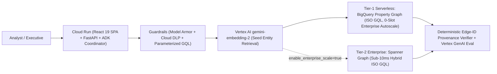

# Enterprise GraphRAG & Contagion Explorer (`solutions/enterprise-graphrag`)

**Ontology-driven multi-hop GraphRAG on Google Cloud — combining Vertex AI `gemini-embedding-2` with ISO/IEC 39075 GQL traversals on BigQuery Property Graph (`$0/mo` idle Tier-1) and Spanner Graph (Tier-2 Enterprise toggle).**

   

## The Problem

Flat vector RAG excels at single-document lookup, but misses **2-to-4 hop risk and contagion chains** split across separate filings, contracts, and sanctions records:
- **Supply Chain**: A chipmaker's SEC `Form SD` names Tier-2/3 smelters, while separate USGS mineral summaries disclose which country dominates that mineral's global refining share.
- **Banking AML / Sanctions**: Individual US Treasury OFAC SDN records only cite direct 1-hop `Linked To:` relationships; uncovering 3-hop indirect exposure requires traversing across multiple SDN entries.
- **Legal M&A Diligence**: Acquisition targets link to commercial agreements containing lawyer-annotated `Change of Control`, `Anti-Assignment`, and `IP Ownership` triggers across distinct governing-law venues.

## Architecture Overview



## Real Public Industry Packs Included (Zero Fabricated Core Data)

Every pack ships with a declarative `pack.yaml` ontology, curated real public excerpts (`92.5%–97.8% REAL_PUBLIC`), SHA-256 `MANIFEST.json`, and 5 path-verified multi-hop golden benchmark questions (`15` total). Full attribution lives in [NOTICE](NOTICE).

| Pack ID | Industry | Real Public Sources | Entities / Edges / Chunks | Real Public Share |
| :--- | :--- | :--- | :---: | :---: |
| **`supply_chain_subtier_risk`** | Manufacturing & Semiconductors | 2026 SEC EDGAR `Form SD` CMRs (Intel, NVIDIA, AMD, QUALCOMM) + USGS 2025 Mineral Commodity Summaries (*US Gov Public Domain*) | `34` / `95` / `9` | **97.8%** |
| **`banking_aml_ubo_contagion`** | Banking AML & Sanctions | US Treasury OFAC SDN/ALT/ADD explicit `Linked To:` multi-hop graph + GLEIF LEI (`CC0 1.0`) | `26` / `33` / `21` | **92.5%** |
| **`legal_ma_clause_graph`** | Corporate Legal & M&A | CUAD v1 (`CC-BY 4.0`) real SEC `Exhibit 10` commercial contracts with lawyer-annotated CoC, Anti-Assignment, License & IP clauses | `43` / `78` / `12` | **92.5%** |

*(Hypothetical disruption scenarios, fictional commercial bank onboarding applicants `SYN-APPLICANT-*`, and portfolio acquisition groupings are explicitly labeled `data_origin="MODELED_BRIDGE"` in every table and UI badge.)*

## Live Verification Snapshot (Phases 1–2 — BigQuery Property Graph ISO GQL + Google ADK `2.15` + Model Armor)

Verified end-to-end against live BigQuery Property Graph (`EnterpriseGraph`, `0`-baseline-slot Enterprise autoscale reservation), `gemini-embedding-2` (`3072`-d on Vertex AI `global`), Discovery Engine Ranking API, **Google ADK `2.15.0`** (`LlmAgent` + `InMemoryRunner` + `BuiltInPlanner`), **Google Cloud Model Armor**, and `gemini-2.5-flash` synthesis:

| Pack | Golden Q | Engine / Traversal | Flat Vector Path Recall | GraphRAG Path Recall | Provenance Verified | Synthesis Cost |
| :--- | :---: | :--- | :---: | :---: | :---: | :---: |
| `supply_chain_subtier_risk` | `sc_q01` | `bq_graphrag` · `outgoing` (3-hop) | `0.00` | **`1.00`** (`100%`) | `100%` (`0` unverified) | `$0.0024` |
| `supply_chain_subtier_risk` | `sc_q01` | `adk_graph_coordinator` (`ADK 2.15` + Model Armor) | `0.00` | **`1.00`** (`100%`) | `100%` (self-verified) | `$0.0070` |
| `supply_chain_subtier_risk` | `sc_q04` | `bq_graphrag` · `incoming` (3-hop) | `0.00` | **`1.00`** (`100%`) | `100%` (`0` unverified) | `$0.0039` |
| `banking_aml_ubo_contagion` | `aml_q01` | `bq_graphrag` · `outgoing` (3-hop) | `0.00` | **`1.00`** (`100%`) | `100%` (`0` unverified) | `$0.0033` |
| `legal_ma_clause_graph` | `ma_q01` | `bq_graphrag` · `both` (`UNION ALL GRAPH_TABLE`) | `0.00` | **`1.00`** (`100%`) | `100%` (`0` unverified) | `$0.0033` |

## Local Verification, UI Dev Server & Live Seeding (Phase 3)

```bash
cd solutions/enterprise-graphrag
uv venv .venv --python python3
uv pip install --python .venv/bin/python -r backend/requirements.txt

# 1. Offline backend unit, security, ADK 2.15 & static guardrail suite (50 tests)
PYTHONPATH=backend .venv/bin/pytest backend/tests -v

# 2. Frontend tests & production React 19 + TypeScript build (strict CSP compliant)
cd frontend && npm install && npm test && npm run build && cd ..

# 3. Launch single-server FastAPI + compiled React 19 SPA locally (localhost-only)
PYTHONPATH=backend .venv/bin/uvicorn app.main:app --host 127.0.0.1 --port 8000

# 4. Optional: seed all 3 packs into BigQuery Property Graph + run live ISO GQL smoke test
cp .env.example .env  # set GCP_PROJECT_ID and DEMO_MODE=live
.venv/bin/python scripts/seed_data.py --pack all --smoke-gql
```

## Build Roadmap

- [x] **Phase 0**: Domain contracts, BigQuery Property Graph & Spanner Graph ISO GQL DDL, real public dataset curator (`3` packs, `15` verified multi-hop questions), `O(N)` canonical entity resolver, and `24` offline tests.
- [x] **Phase 1**: `Flat Vector RAG` baseline, `BigQuery Property Graph` ISO GQL engine (hybrid vector + canonical-name seeding, `MATCH p = ANY SHORTEST`, Discovery Engine reranking), `Spanner Graph` Tier-2 adapter (parked at `$0/mo`), deterministic Edge-ID provenance verifier, `StageEmitter` SSE telemetry, Replay recorder/runner, idempotent BigQuery seeder (`scripts/seed_data.py`), live 3-pack ISO GQL verification, and `39` passing tests.
- [x] **Phase 2**: **Google ADK `2.15.0`** Graph Coordinator (`LlmAgent` + `InMemoryRunner` + self-verifying citation loop), multimodal `/ingest` BYO-ontology pipeline (PyMuPDF + image vision + Cloud DLP PII-safe preview + canonical resolution + BigQuery staging `MERGE`), Google Cloud **Model Armor** REST screening, strict CSP/CORS/rate-limit/IAP `ES256` JWT security middleware, FastAPI SSE routes, live ADK + Model Armor verification, and `50` passing tests.
- [x] **Phase 3**: Interactive **React 19 + TypeScript + `d3-force`** SPA (`/` Contagion Explorer with ontology-coded SVG canvas & clickable SEC/OFAC/CUAD Evidence Inspector, `/compare` Flat Vector vs. GraphRAG Battle Lab, `/ingest` BYO-Ontology & Multimodal Upload Wizard, `/benchmark` Monthly GCP TCO & ROI Calculator + formula-safe CSV Executive Brief export), zero inline styles (strict `style-src 'self'` CSP verified), and `5` frontend unit & security guardrail suites.
- [ ] **Phase 4**: Cross-family LLM judge + Vertex GenAI Eval (`:evaluateInstances`) + live `DEMO_MODE=record` Replay fixtures.
- [ ] **Phase 5**: Tier-1 + Tier-2 Terraform, `scripts/deploy.sh`, and live Cloud Run verification.
