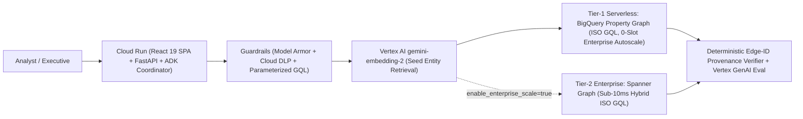

# Enterprise GraphRAG & Contagion Explorer (`solutions/enterprise-graphrag`)

**Ontology-driven multi-hop GraphRAG on Google Cloud — combining Vertex AI `gemini-embedding-2` with ISO/IEC 39075 GQL traversals on BigQuery Property Graph (`\$0/mo` idle Tier-1) and Spanner Graph (Tier-2 Enterprise toggle).**

   

## The Problem

Flat vector RAG excels at single-document lookup, but misses **2-to-4 hop risk and contagion chains** split across separate filings, contracts, and sanctions records:
- **Supply Chain**: A chipmaker's SEC `Form SD` names Tier-2/3 smelters, while separate USGS mineral summaries disclose which country dominates that mineral's global refining share.
- **Banking AML / Sanctions**: Individual US Treasury OFAC SDN records only cite direct 1-hop `Linked To:` relationships; uncovering 3-hop indirect exposure requires traversing across multiple SDN entries.
- **Legal M&A Diligence**: Acquisition targets link to commercial agreements containing lawyer-annotated `Change of Control`, `Anti-Assignment`, and `IP Ownership` triggers across distinct governing-law venues.

## Architecture Overview



## Real Public Industry Packs Included (Zero Fabricated Core Data)

Every pack ships with a declarative `pack.yaml` ontology, curated real public excerpts (`92.5%–97.8% REAL_PUBLIC`), SHA-256 `MANIFEST.json`, and 5 path-verified multi-hop golden benchmark questions (`15` total). Full attribution lives in [NOTICE](NOTICE).

| Pack ID | Industry | Real Public Sources | Entities / Edges / Chunks | Real Public Share |
| :--- | :--- | :--- | :---: | :---: |
| **`supply_chain_subtier_risk`** | Manufacturing & Semiconductors | 2026 SEC EDGAR `Form SD` CMRs (Intel, NVIDIA, AMD, QUALCOMM) + USGS 2025 Mineral Commodity Summaries (*US Gov Public Domain*) | `34` / `95` / `9` | **97.8%** |
| **`banking_aml_ubo_contagion`** | Banking AML & Sanctions | US Treasury OFAC SDN/ALT/ADD explicit `Linked To:` multi-hop graph + GLEIF LEI (`CC0 1.0`) | `26` / `33` / `21` | **92.5%** |
| **`legal_ma_clause_graph`** | Corporate Legal & M&A | CUAD v1 (`CC-BY 4.0`) real SEC `Exhibit 10` commercial contracts with lawyer-annotated CoC, Anti-Assignment, License & IP clauses | `43` / `78` / `12` | **92.5%** |

*(Hypothetical disruption scenarios, fictional commercial bank onboarding applicants `SYN-APPLICANT-*`, and portfolio acquisition groupings are explicitly labeled `data_origin="MODELED_BRIDGE"` in every table and UI badge.)*

## Local Verification (Phase 0)

```bash
cd solutions/enterprise-graphrag
uv venv .venv --python python3
uv pip install --python .venv/bin/python pydantic pydantic-settings pyyaml httpx pytest fastapi
PYTHONPATH=backend .venv/bin/pytest backend/tests -v

# Optional: refresh curated public packs directly from official upstream APIs
.venv/bin/python scripts/fetch_public_datasets.py --cache-dir /tmp/graphrag_public_cache
```

## Build Roadmap

- [x] **Phase 0**: Domain contracts, BigQuery Property Graph & Spanner Graph ISO GQL DDL, real public dataset curator (`3` packs, `15` verified multi-hop questions), `O(N)` canonical entity resolver, and `24` offline tests.
- [ ] **Phase 1**: `Flat Vector RAG` baseline + `BigQuery Property Graph` ISO GQL engine + `Spanner Graph` adapter + deterministic Edge-ID provenance verifier + `StageEmitter` SSE + live BigQuery seeding.
- [ ] **Phase 2**: Google ADK Graph Coordinator, multimodal `/ingest` BYO-ontology pipeline, Model Armor & Cloud DLP guardrails, and security test suite.
- [ ] **Phase 3**: Interactive React 19 UI (`/` Force-Directed Graph Canvas, `/compare` Vector vs. GraphRAG Lab, `/ingest`, `/benchmark` & Monthly TCO Calculator).
- [ ] **Phase 4**: Cross-family LLM judge + Vertex GenAI Eval (`:evaluateInstances`) + live `DEMO_MODE=record` Replay fixtures.
- [ ] **Phase 5**: Tier-1 + Tier-2 Terraform, `scripts/deploy.sh`, and live Cloud Run verification.
