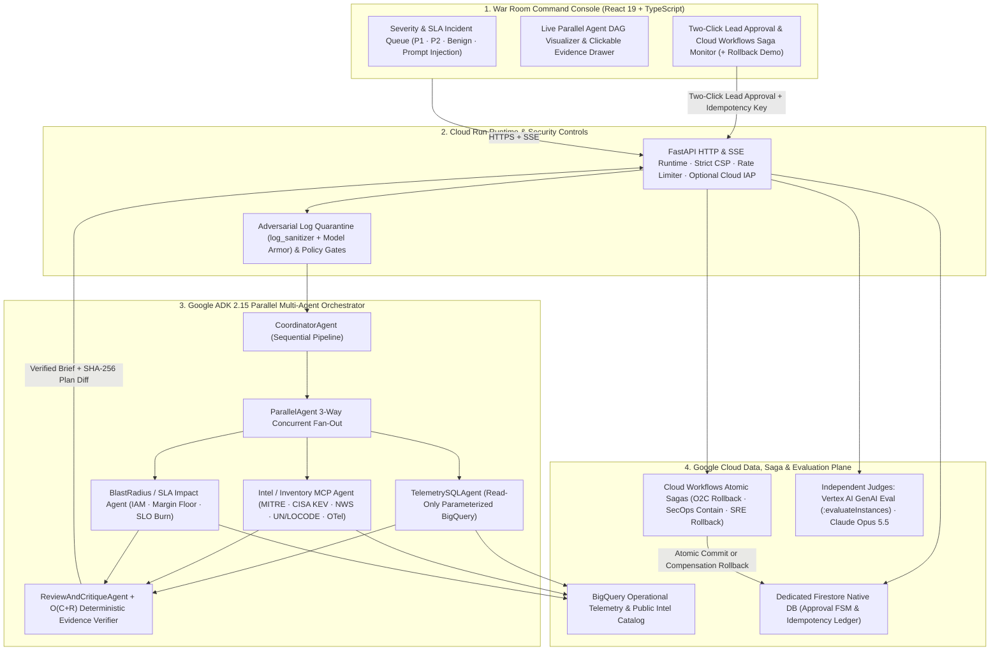

# Operations & Incident War Room — Multi-Agent Triage & Atomic Remediation on Google Cloud

**Compress 45–75 minute swivel-chair incident triage into parallel multi-agent investigations with adversarial log-injection defense, deterministic citation verification, mandatory two-click lead approval, and atomic Cloud Workflows sagas.**

-34A853.svg)   

---

## The Problem This Solves

Operations teams across **Cybersecurity (SOC)**, **Supply Chain Order-to-Cash**, and **Cloud SRE** face the same high-pressure bottleneck: when an incident fires, specialists spend **45–75 minutes** jumping across siloed log tables, vulnerability/inventory feeds, and runbooks while risking slow response, premature autonomous mutations on false positives, or hidden prompt-injection payloads buried inside attacker-controlled logs.

| Operational Domain | Swivel-Chair Triage Bottleneck | Manual Baseline | How the Multi-Agent War Room Solves It |
| :--- | :--- | :---: | :--- |
| **Cybersecurity SOC & Cloud SIEM** | Correlating Cloud Audit, VPC Flow, and IAM events against active CVEs and MITRE ATT&CK techniques while defending against prompt injection hidden inside HTTP headers. | **45 min** (`$55` / alert) | Fans out 3 specialist agents in parallel across BigQuery logs + MITRE/CISA KEV intel, quarantines injected log payloads, clears authorized red-team drills, and drafts least-privilege IAM diffs. |
| **Supply Chain Order-to-Cash** | Port weather holds and warehouse stockouts force manual reconciliation across ERP, WMS, and carrier portals—and partial multi-system updates leave orphaned stock. | **75 min** (`$110` / case + `$12k` SLA risk) | Evaluates split-shipment vs. air-freight against a deterministic 65% margin floor and executes approved reroutes via atomic **Cloud Workflows** with automatic WMS rollback on carrier failure. |
| **Cloud SRE & Outage Commander** | p99 latency and 5xx spikes require correlating recent canary deploys, DB connection pools, and SLO burn rates without rolling back on scheduled load tests. | **50 min** (`$85` / incident) | Correlates Cloud Logging, deploy history, and OpenTelemetry burn-rate math in parallel to distinguish genuine canary regressions from benign shadow tests and produce verified rollback diffs. |

---

## Target Business & Technical Impact

- **Parallel Wall-Clock Speedup**: Fans out **Telemetry SQL**, **Intel / Inventory MCP**, and **Blast-Radius / SLA Impact** specialists concurrently via Google ADK `ParallelAgent` ($\max(t_1, t_2, t_3)$ instead of serial $t_1 + t_2 + t_3$).
- **Zero Autonomous Production Mutations**: Enforces a strict finite state machine (`PENDING_TRIAGE -> TRIAGED -> DRY_RUN_PREVIEWED -> APPROVED_BY_LEAD -> SAGA_EXECUTING -> SAGA_COMPLETED | SAGA_ROLLED_BACK`) requiring an immutable SHA-256 plan digest and two-click lead approval before any workflow executes.
- **Adversarial Log-Injection Resistance**: Quarantines raw untrusted log strings (`User-Agent`, headers, carrier notes) using deterministic detection + Model Armor while verifying every `[EVENT:...]` and `[INTEL:...]` citation against retrieved records in $\mathcal{O}(C+R)$ time.
- **Serverless Economics (`$0–$3/mo` Idle)**: Runs on Cloud Run (`min-instances=0`), BigQuery on-demand, an isolated named Firestore Native database, and Cloud Workflows—scaling cleanly to Tier-2 Enterprise connectors (Apigee, Application Integration, Google SecOps Chronicle, Private Service Connect) via Terraform.

---

## System Architecture



### Architecture Component Breakdown

| Layer | Component | GCP Service / Technology | Responsibility |
| :--- | :--- | :--- | :--- |
| **Domain Contracts & FSM** | `backend/app/core/models.py` | Python Dataclasses + Enum FSM | Enforces illegal-state-unrepresentable transitions (`APPROVED_BY_LEAD` + SHA-256 `plan_sha256` required before execution; `BENIGN_FALSE_POSITIVE` mutations blocked). |
| **Adversarial Defense** | `backend/app/core/log_sanitizer.py` | Deterministic Scanner + Model Armor | Detects direct and base64-encoded prompt injections inside raw log fields and wraps untrusted strings as inert data while preserving structured audit columns. |
| **Provenance & Policy** | `backend/app/core/evidence_verifier.py` | Deterministic `O(C+R)` Verifier | Validates every `[EVENT:...]`, `[CVE:...]`, `[TECHNIQUE:...]`, and `[RUNBOOK:...]` citation against retrieved records and enforces the 65% supply-chain margin floor. |
| **Public Data Packs** | `packs/` + `scripts/fetch_public_datasets.py` | MITRE STIX · CISA KEV · NWS · UN/LOCODE · GCP Status · OTel | Curates 3 declarative packs (`15` incidents, `72` real public intel records, SHA-256 `MANIFEST.json`). |
| **Multi-Agent Engines** | `backend/app/engines/{adk_war_room,serial_baseline}.py` | Google ADK `2.15` (`ParallelAgent` + `SequentialAgent`), Vertex AI Gemini | Fans out 3 specialist `LlmAgent`s concurrently into `ReviewAndCritiqueAgent` with self-verifying citations (paired against a single-agent serial baseline). |
| **Telemetry & MCP Tools** | `backend/app/engines/{safe_bq_runner,mcp_registry}.py` | BigQuery (Parameterized Read-Only SQL), Declarative `mcp_registry.yaml` | Enforces `SELECT`-only parameterized queries (`100 MiB` byte cap) and SSRF-validated Tier-1/Tier-2 MCP tool adapters. |
| **Atomic Sagas & Ledger** | `backend/app/engines/workflows_executor.py`, `infra/workflows/*.yaml` | Google Cloud Workflows + Dedicated Firestore Native DB | Enforces two-click SHA-256 approval digests, idempotency keys, and `try/except` automatic compensation rollback (`SAGA_COMPLETED` / `SAGA_ROLLED_BACK`). |
| **Data & TCO** | `infra/sql/bigquery_schema.sql` + `core/pricing.py` | BigQuery (Partitioned/Clustered) | Stores telemetry, public intel, runbooks, and immutable remediation audit trails alongside Tier-1 vs. Tier-2 Monthly TCO modeling. |

---

## Included Industry Packs (Real Public Data)

Full third-party licenses and attributions live in [NOTICE](NOTICE). Synthetic incident streams linking real public intelligence to fictional tenants or orders are explicitly tagged `data_origin="MODELED_BRIDGE"`.

| Pack ID | Industry & Persona | Real Public Data Sources Curated | Incidents / Events / Public Intel | Real Public Share |
| :--- | :--- | :--- | :---: | :---: |
| **`secops_siem_triage`** | Cybersecurity SOC (*SOC Lead / CISO*) | Live **CISA KEV Catalog** (*US Gov Public Domain*), **MITRE ATT&CK Enterprise STIX 2.1** (`Apache 2.0`), **NIST SP 800-61r3** | `5` / `11` / `27` | **73.8%** |
| **`supply_chain_o2c_saga`** | Supply Chain & CPG (*VP Order Operations*) | Live **UNECE UN/LOCODE** (`PDDL v1.0`), **NOAA NWS Severe Weather Alerts** (*US Gov Public Domain*) | `5` / `8` / `27` | **78.9%** |
| **`sre_outage_commander`** | Cloud Platform Engineering (*Head of SRE*) | Live **Google Cloud Service Health Incidents**, **OpenTelemetry Semantic Conventions** (`Apache 2.0`), **Google SRE Burn-Rate Standard** | `5` / `6` / `18` | **77.8%** |

---

## Project Structure

```text
solutions/ops-war-room/
├── NOTICE                            # Public dataset licenses & attributions
├── .env.example                      # Local runtime configuration template
├── backend/
│   ├── requirements.txt              # Python dependencies (FastAPI, ADK 2.15, BigQuery, Firestore, Workflows)
│   ├── app/
│   │   ├── core/
│   │   │   ├── models.py             # Domain contracts & Remediation/Saga FSM
│   │   │   ├── log_sanitizer.py      # Adversarial log prompt-injection detector & quarantine
│   │   │   ├── evidence_verifier.py  # O(C+R) citation verifier & deterministic policy gates
│   │   │   ├── gcp_clients.py        # Lazy thread-safe BigQuery, Vertex AI, Firestore & Workflows pool
│   │   │   ├── stage_emitter.py      # Async SSE telemetry emitter for parallel DAG visualization
│   │   │   ├── config.py             # Runtime settings, model catalog & judge != synthesis guard
│   │   │   ├── pricing.py            # Per-query & Tier-1/Tier-2 Monthly TCO/ROI calculator
│   │   │   └── attribution.py        # Resource naming & GCP FinOps label helpers
│   │   ├── engines/
│   │   │   ├── adk_war_room.py       # Google ADK 2.15 ParallelAgent 3-way fan-out + ReviewAndCritiqueAgent
│   │   │   ├── serial_baseline.py    # Single-Agent Serial Baseline for /compare benchmarking
│   │   │   ├── safe_bq_runner.py     # Parameterized read-only BigQuery telemetry runner (100 MiB cap)
│   │   │   ├── mcp_registry.py       # SSRF-hardened MCP tool registry & Tier-1 sandbox adapters
│   │   │   ├── workflows_executor.py # Two-click approval ledger & live Cloud Workflows saga executor
│   │   │   └── replay.py             # Zero-credential Replay recorder, scrubber & SSE fixture player
│   │   └── packs/loader.py           # Declarative pack.yaml loader with SHA-256 MANIFEST check
│   └── tests/                        # 29 offline tests (FSM, sanitizer, ADK, MCP SSRF, Workflows, Replay)
├── packs/
│   ├── mcp_registry.yaml             # Declarative Tier-1 sandbox & Tier-2 external MCP contracts
│   ├── secops_siem_triage/           # pack.yaml + corpus/{incidents,telemetry,intel,runbooks,MANIFEST}.json
│   ├── supply_chain_o2c_saga/        # pack.yaml + corpus/{incidents,telemetry,intel,runbooks,MANIFEST}.json
│   └── sre_outage_commander/         # pack.yaml + corpus/{incidents,telemetry,intel,runbooks,MANIFEST}.json
├── data/
│   └── releases.json                 # Release notes metadata
├── infra/
│   ├── sql/bigquery_schema.sql       # Partitioned & clustered BigQuery DDL (5 tables)
│   └── workflows/                    # Atomic Cloud Workflows YAML sagas (O2C, SecOps, SRE)
└── scripts/
    ├── fetch_public_datasets.py      # Reproducible live public dataset curator
    └── seed_data.py                  # Idempotent BigQuery dataset/table seeder
```

---

## Quickstart (Local Verification)

```bash
cd solutions/ops-war-room

# 1. Create an isolated Python virtual environment and install dependencies
uv venv .venv --python python3
uv pip install --python .venv/bin/python -r backend/requirements.txt

# 2. (Optional) Refresh curated public datasets from live CISA/MITRE/NWS/UN-LOCODE/GCP feeds
.venv/bin/python scripts/fetch_public_datasets.py

# 3. Run the offline verification suite
PYTHONPATH=backend .venv/bin/pytest backend/tests -v
```
